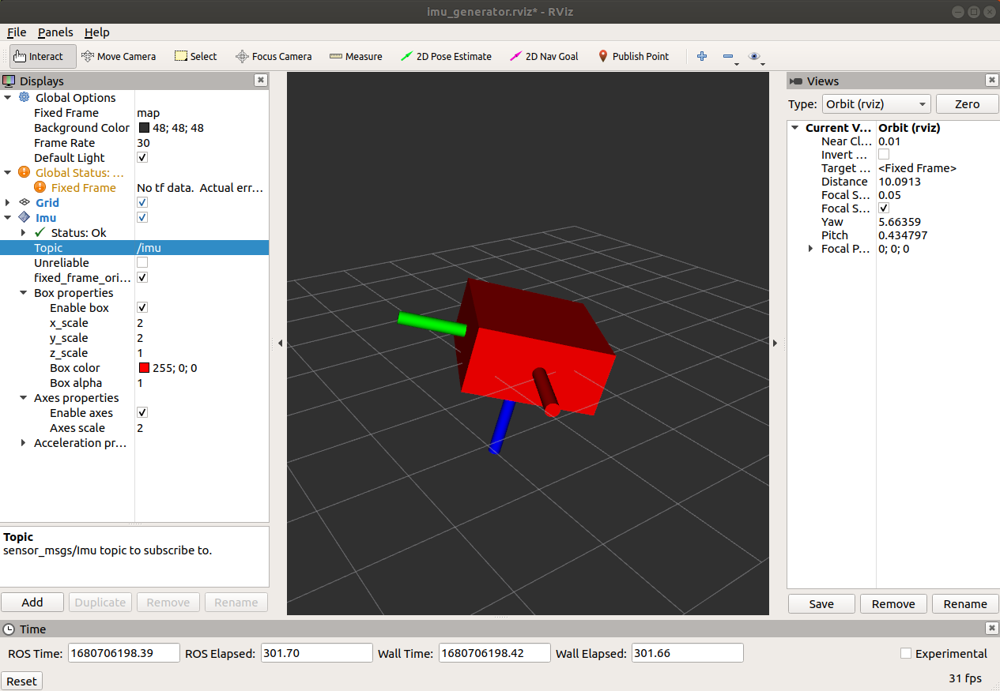

Visualizing the IMU data in ROS 2
=================================

While getting raw data in a terminal log demonstrates we have a proper IMU connection, we can also visualize the IMU orientation in Rviz.

.. shell::

    $ make ros-sdk-run-imu-vis
    # or
    $ docker compose run -it imu_vis
    # or start ROS shell and run this inside:
    $ ros2 launch adi_imu imu_with_madgwick_filter_rviz.launch.py \
        iio_context_string:="ip:12.34.56.78" \
        imu_device_name:="adis16607-3"

You should see something like this:

Behind the scenes, this runs:

* a Madgwick filter to integrate IMU data into an orientation estimate
* Rviz to display the orientation estimate
